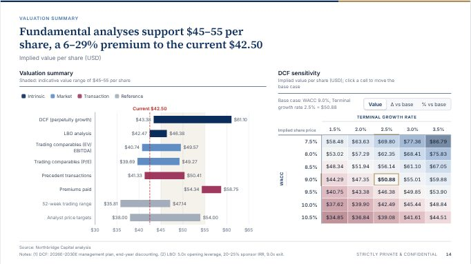
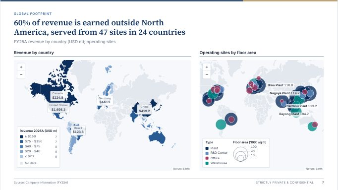
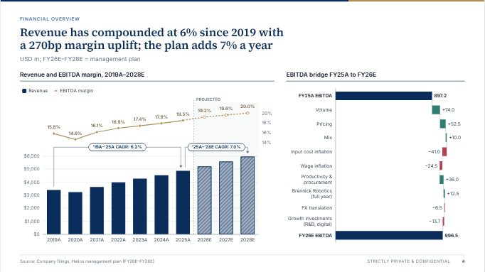
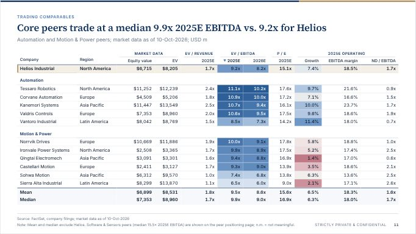

# ReportKit · 投行客户报告可视化组件框架

把 Python / SQL 的分析结果生成**投行 pitchbook 质感**的交互式客户报告：输出是一个**离线可用、HTML · CSS · JS · 数据严格分离**的文件夹（也可以是单个 HTML 文件 + Excel 底稿）。
客户双击 `index.html` 即可打开，可以缩放、筛选、交叉联动、切换指标与维度、做 what-if 假设分析、输入自己的公式查询，也能一键打印成 16:9（或 Letter / A4）PDF。

<p>




</p>

> 以上截图来自示例报告 **Project Atlas**（虚构公司与数据）：[`examples/demo-pitchbook/index.html`](examples/demo-pitchbook/index.html) · [PDF](examples/demo-pitchbook.pdf)

## 一眼看懂：需求 → 实现

| 需求 | ReportKit 怎么做 | 详见 |
|---|---|---|
| 离线交付，HTML / CSS / JS / 数据分离 | `index.html` 只放版式与绑定；`assets/` 放样式、运行时、组件和第三方库；`data/` 里每个数据集一个 JSON（另有 `bundle.js` 供双击 `file://` 打开）。不依赖 CDN、在线瓦片或外部字体 | [交付形式](#交付形式) |
| 缩放 | 时间序列滑块缩放、Ctrl/⌘ + 滚轮或触控板捏合缩放（普通滚轮仍滚动页面）；地图缩放平移 | [交互能力](#交互能力) |
| 筛选、交叉联动 | 顶栏全局筛选；点击任意图表元素交叉筛选其他图表；页脚自动标注 “Filtered view: …”，模块标题栏显示 “Filtered” 徽标；可指定某页不受筛选影响 | [交互能力](#交互能力) |
| 切换维度 / 指标 | 模块标题栏的指标 / 维度下拉框（`choices`）；情景切换器；参数滑块（what-if） | [Phase 1 新能力](#python-构建器phase-1-新能力) |
| 客户手动输入指标、自助查询 | `query-console`：构建器 + 查询语句（如 `median(ev_ebitda_25e) by sector from peers where region == "Europe"`）；自定义公式可“添加为指标”，全报告可用，并按报告保存在客户本机浏览器 | [公式与查询语言](docs/formula-language.md) |
| 组件分门别类，说明能展示什么 | **57 个组件、12 个类别**；gallery 网站为每个组件提供实时示例、适用 / 不适用场景、数据通道、全部配置项和 Python / HTML / JSON 代码 | [组件库](#组件库) |
| GS / J.P. Morgan pitchbook 风格，主题可换 | action title（数字可随筛选实时重算）+ 单位副标题 + Source / Notes / 保密声明 / 页码；navy、bronze、slate、ink 四套主题运行时切换 | [设计规范](docs/design-system.md) |
| 中文客户 | `locale="zh-CN"`：中文界面文字、万 / 亿 紧凑单位、中文日期；`updown="cn"`：红涨绿跌 | [语言与涨跌色](#语言与涨跌色) |
| Step 2：客户 skills + 本地大模型 | 数据 API 适配器已可用；skills 导入、本地模型接入（只输出查询 / 公式 / block 规格，不输出代码）的路线图 | [Step 2](#step-2) |

---

## 快速开始

```bash
# 1) 组件库网站：分门别类展示全部组件（双击即可，离线可用）
open gallery/index.html

# 2) 生成示例报告（构建器只依赖 Python 标准库；pandas / openpyxl 可选）
python3 py/examples/build_demo.py                      # -> examples/demo-pitchbook/（英文 pitchbook：Project Atlas）
python3 py/examples/build_demo.py out/x --single-file --excel   # -> out/x/project-atlas.html + .xlsx
python3 py/examples/build_demo_zh.py                   # -> examples/demo-zh-cn/（中文报告：远航项目）
python3 py/examples/sql_pipeline.py                    # SQL -> pandas -> metrics -> 报告 -> examples/sql-pipeline-report/

# 3) 打开生成的报告（双击即可）
open examples/demo-pitchbook/index.html
```

示例报告：

| 路径 | 内容 |
|---|---|
| [`examples/demo-pitchbook/`](examples/demo-pitchbook/index.html)（+ [PDF](examples/demo-pitchbook.pdf)） | **Project Atlas** 董事会讨论材料：由 [`py/examples/build_demo.py`](py/examples/build_demo.py) 用 `kit/samples/` 的示例数据生成，覆盖估值、交易表现、财务、全球布局、可比公司、交易流程等章节，集中演示各类组件与全部交互（筛选联动、标题模板、指标切换、what-if、查询控制台、打印 PDF） |
| [`examples/demo-zh-cn/`](examples/demo-zh-cn/index.html)（+ [PDF](examples/demo-zh-cn.pdf)） | **远航项目**（中文）：A+H 上市收购方拟收购一家德国精密驱动企业的买方顾问材料，由 [`py/examples/build_demo_zh.py`](py/examples/build_demo_zh.py) 生成；演示 `Report(locale="zh-CN", updown="cn")`：中文界面文字、万 / 亿 单位、中文日期、红涨绿跌、“单位：人民币亿元”式副标题与 `china-tilemap` |
| [`examples/sql-pipeline-report/`](examples/sql-pipeline-report/index.html) | **Project Kestrel**：[`py/examples/sql_pipeline.py`](py/examples/sql_pipeline.py) 从 SQLite 原始表 → SQL view → pandas（或纯标准库）→ 报告的完整链路，讲解见 [`docs/pipeline-guide.md`](docs/pipeline-guide.md) |

### 在自己的分析流程里

下面的代码在仓库根目录可直接运行（用 kit 自带的示例数据；实际项目里把路径换成 DataFrame 即可）：

```python
from reportkit import Report            # PYTHONPATH=py 或 pip install -e py

r = Report("Project Atlas", subtitle="Discussion materials", client="Board of Directors",
           date="2026-10-14", theme="navy", firm="Northbridge Capital")
# 数据集：DataFrame / records / CSV / JSON 路径均可；这里直接用 kit 自带的示例数据
r.dataset("peers", "kit/samples/datasets/peers.json", source="FactSet; market data as of 10-Oct-2026")
r.dataset("valuation", "kit/samples/datasets/valuation_ranges.json", source="Northbridge analysis")
r.topbar_block("filter-bar", data="peers", options={"filters": [
    {"field": "sector", "type": "multi", "label": "Sector"},
    {"field": "region", "type": "multi", "label": "Region"}]})

# action title 里的数字是模板：客户筛选到 Europe 时随之重算
p = r.page("Peers trade at a median {{peers: median(ev_ebitda_25e) | 0.0x}} 2025E EBITDA",
           kicker="Valuation", subtitle="{{peers: count()}} companies · USD m")
p.block("football-field", data="valuation", title="Implied value per share", span=5, height=360,
        encode={"label": "method", "low": "low", "high": "high", "group": "group"},
        options={"refLines": [{"value": 42.5, "label": "Current $42.50"}]})
p.block("bar", data="peers", title="Trading multiples", span=7, height=360,
        encode={"x": "company", "y": "ev_ebitda_25e"},
        options={"orientation": "horizontal", "sort": "desc",
                 "choices": {"y": ["ev_ebitda_25e", "ev_revenue_25e", "pe_25e", "*computed"]}})  # 指标下拉框

a = r.page("Full peer universe", kicker="Appendix", filters=False)   # 本页不受筛选影响
a.block("comps-table", data="peers", height="auto", encode={"label": "company", "highlight": "is_target"},
        options={"groupBy": "sector", "stats": ["mean", "median"],
                 "columns": ["mkt_cap", "ev", "ev_revenue_25e", "ev_ebitda_25e", "pe_25e", "rev_growth_25e"]})

r.build("out/atlas")                                   # 文件夹：双击 out/atlas/index.html
r.build("out/delivery", single_file=True, excel=True)  # 单文件 HTML + Excel 底稿（需要 openpyxl）
```

完整指南：[`py/README.md`](py/README.md)（Python API、JSON 规格、命令行）· [`docs/pipeline-guide.md`](docs/pipeline-guide.md)（SQL → 报告的分析师工作流）·
[`docs/architecture.md`](docs/architecture.md)（数据 / HTML / 组件契约与运行时 API）。

## 交付形式

同一份 `Report` 可以输出三种交付物（可以同时输出）：

| 形式 | 生成方式 | 产物 | 适合 | 注意 |
|---|---|---|---|---|
| **文件夹**（默认） | `r.build("out/atlas")` · `python -m reportkit build spec.json out/atlas` | `index.html` + `assets/` + `data/`（每个数据集一个 JSON + `bundle.js`） | 内网 / SharePoint 静态托管；git 审阅数据变化（每行一条记录）；以后切换数据 API | 以 zip 发送时，客户须先“全部解压”再双击；部分邮件网关会拦截含 `.js` 的压缩包 |
| **单文件 HTML** | `single_file=True` · `--single-file` | 一个 `<slug>.html`：CSS、字体（`data:` URI）、第三方库、运行时、组件和数据全部内联（一般 2–4 MB，视组件与数据而定） | 邮件附件、数据室上传；无需解压；打开时**零网络请求** | 数据不再是独立文件；数据很大（> 50k 行，构建时会警告）时仍建议文件夹；HTML 附件可能被邮件网关拦截，走公司安全传输渠道 |
| **Excel 底稿** | `excel=True` · `--excel`（需要 `openpyxl`：`pip install -e "py[xlsx]"`） | 文件夹模式 `data/<slug>.xlsx`；单文件模式在 html 旁边 `<slug>.xlsx`；报告右上角出现 Excel 下载按钮 | 客户要底稿、复核数字 | 只含数据：每个数据集一个工作表（Source / Notes / Unit / As of 行、数字格式沿用字段格式码、真正的日期、冻结表头、筛选）；computed 字段以注释行列出公式；单文件模式下 xlsx 要和 html 放在同一目录一起发送，下载按钮才有效 |

另外，`data_source="api", api="https://host/api/reports/42/"` 让页面运行时从数据 API 取数（与 `data/` 完全相同的 JSON 形状，可与单文件同用）：见 [`docs/pipeline-guide.md`](docs/pipeline-guide.md) §9。

### 输出的报告文件夹（结构化、数据独立）

```
out/atlas/
  index.html                 只有版式与绑定（哪个组件、绑定哪个数据集、options）
  assets/css/reportkit.css   设计 token + 主题 + 版式 + 已用组件样式
  assets/js/reportkit.js     运行时（classic script，file:// 可用）
  assets/js/components/*.js  只打包本报告用到的组件
  assets/vendor/*            只打包用到的第三方库（附 LICENSE；例如用了 basemap: "world-50m" 才带高精度底图）
  assets/fonts/              离线字体（Inter, Source Serif 4；OFL）
  data/manifest.json         报告元信息 + 数据集索引 + 参数
  data/datasets/<id>.json    每个数据集一个文件：schema + records + meta(source/notes/unit)
  data/bundle.js             同一份数据的 file:// 版本（双击打开时使用）
  data/<slug>.xlsx           （excel=True 时）Excel 底稿
```

- **数据与版式分离**：数据集是独立 JSON（Frictionless Table Schema 风格 + Excel 格式码），可直接换成数据 API（同样的 JSON 形状，见 [`docs/architecture.md`](docs/architecture.md) §3–§4）。
- **离线**：不依赖任何 CDN / 在线瓦片 / 外部字体；世界底图来自 Natural Earth（随库打包）。第三方库版本固定并记录 sha256，`python3 tools/vendor.py --check` 校验。

## 组件库

**57 个组件 · 12 个类别**。在 [`gallery/index.html`](gallery/index.html) 中每个组件都有：实时示例（多种变体）、能展示什么 / 适用与不适用场景、
数据通道（channel → 字段）、全部配置项、交互说明、Python / HTML / JSON 用法代码、示例数据预览。
自动生成的完整目录（含数据通道）：[`docs/component-catalog.md`](docs/component-catalog.md)；命令行：`python -m reportkit components [--category geo]`。

**版式与叙事 · Layout & narrative（3）**

| 组件 | 名称 | 能展示什么 |
|---|---|---|
| `tombstones` | 交易业绩墓碑卡 | 每笔交易一张卡片：交易类型、交易双方、金额、日期与本行角色；可按行业 / 地区筛选 |
| `kpi-tiles` | 关键指标卡 | 关键数字 + 同比 / 环比变化（自动判断好坏方向）+ 迷你趋势线 |
| `text-block` | 叙事文本块 | 要点卡片、强调框、引言、大数字统计；`{{字段\|格式}}` 占位符从数据实时取数 |

**交互控件与查询 · Controls & query（4）**

| 组件 | 名称 | 能展示什么 |
|---|---|---|
| `filter-bar` | 全局筛选栏 | 多选、区间、搜索、开关筛选，并以标签汇总当前筛选（含图表交叉筛选），可一键清除 |
| `param-slider` | 参数滑块（假设分析） | 拖动 `@wacc` 等参数，引用它的公式字段和图表实时重算；显示相对基准的变动（百分比参数用 bps / pp） |
| `query-console` | 自助分析控制台 | 构建器 + 查询编辑器（实时校验），结果表 + 自动图表、CSV 导出、查询历史、“添加为指标”与“我的指标” |
| `scenario-switch` | 情景切换器 | 基准 / 乐观 / 悲观分段切换，为整份报告设置情景筛选或共享状态 |

**估值分析 · Valuation（3）**

| 组件 | 名称 | 能展示什么 |
|---|---|---|
| `avp-table` | 不同报价下的估值分析表（AVP） | 列为不同报价，行为溢价、隐含股权价值、企业价值与隐含倍数，全部实时计算 |
| `football-field` | 估值足球场图 | 各估值方法的估值区间浮动条，叠加现价 / 报价参考线 |
| `sotp` | 分部加总估值（SOTP） | 各板块“指标 × 倍数区间”累加为企业价值，扣除调整项得到每股价值区间 |

**时间趋势 · Change over time（8）**

| 组件 | 名称 | 能展示什么 |
|---|---|---|
| `calendar-heatmap` | 日历热力图 | 按日的交易活跃度，或年 × 月的月度回报网格 |
| `candlestick` | K 线图（OHLC）与成交量 | 日 K 线 + 成交量副图、移动均线、事件标注，可缩放 |
| `combo` | 柱线组合图（双轴） | 如收入柱 + EBITDA 利润率线，预测年份斜线填充，CAGR 标注 |
| `line` | 折线图 / 面积图 | 多系列趋势：重设基数为 100、目标公司高亮、线端标注、预测期虚线、事件标注 |
| `price-volume` | 股价与成交量图 | 股价线 + 成交量副图、均线、52 周高低、VWAP、事件标注 |
| `slope` | 斜率图（两期对比） | 每个对象在两个时点之间的升降 |
| `small-multiples` | 小多图（分面趋势） | 每个板块 / 地区一个迷你图，共享或独立 y 轴，十字准线联动 |
| `multiple-history` | 历史估值倍数走势图 | NTM EV/EBITDA（或 P/E）历史 + 均值线 + ±1σ / ±2σ 带 + 同业中位数 |

**规模与排名 · Magnitude & ranking（7）**

| 组件 | 名称 | 能展示什么 |
|---|---|---|
| `bar` | 柱状图 / 条形图 | 类别比较：分组、堆叠、百分比堆叠、横向排名 |
| `bullet` | 子弹图 | 实际值对比目标值，背景为定性区间（差 / 中 / 好） |
| `bump` | 排名变化图（Bump Chart） | 排名随时间（或跨市场）的变化 |
| `dumbbell` | 哑铃图 / 区间点图 | 每个类别两个数值的对比：前后、预期 vs 实际、52 周区间 + 现价 |
| `lollipop` | 棒棒糖排名图 | 类别较多时的清爽排名，可加第二个数值点（如 2025E vs 2026E） |
| `parallel` | 平行坐标图 | 多指标同时比较，在任一轴上拖选区间即交叉筛选 |
| `radar` | 雷达图（蛛网图） | 在 4–8 个维度上对标目标公司与同业 |

**桥接与偏差 · Bridges & deviation（2）**

| 组件 | 名称 | 能展示什么 |
|---|---|---|
| `diverging-bar` | 正负偏差条形图 | 相对 0 或基准（如同业中位数）的正负偏差：超 / 不及预期、TSR、预算差异 |
| `waterfall` | 瀑布图 / 桥接图 | EBITDA 桥、企业价值 → 股权价值桥、预算差异分析 |

**结构占比 · Part-to-whole（5）**

| 组件 | 名称 | 能展示什么 |
|---|---|---|
| `donut` | 环形图 / 饼图 | 构成占比，中心总数，超出数量自动归入“其他” |
| `marimekko` | 马赛克图 / 市场地图 | 柱宽 = 细分市场规模，柱内堆叠 = 各参与者份额 |
| `sunburst` | 旭日图 | 径向层级结构，点击下钻 |
| `treemap` | 矩形树图 | 面积 = 数值，颜色 = 分组或指标（如增长率），点击下钻 |
| `waffle` | 华夫饼图（百格图） | 10 × 10 百格（每格 1%）表达占比，可分面 |

**分布与相关 · Distribution & correlation（6）**

| 组件 | 名称 | 能展示什么 |
|---|---|---|
| `beeswarm` | 蜂群分布图 | 每个观测值一个点，叠加四分位与中位数，看清离散程度与目标公司位置 |
| `boxplot` | 箱线图（分组分布） | 四分位箱体、中位数、均值、离群点，并标出目标公司 |
| `bubble` | 气泡图（四维散点） | 横轴、纵轴、面积、颜色四个维度，可按时间播放 |
| `heatmap` | 热力矩阵图 | 相关系数矩阵、月度收益表、同业评分卡 |
| `histogram` | 直方图（分布） | 单一指标的分箱分布 + 核密度 + 中位数 / 均值线 |
| `scatter` | 散点图（回归 / 象限） | 两个指标的关系：回归线与 R²、中位数象限、框选交叉筛选 |

**流向与关系 · Flow & relationships（5）**

| 组件 | 名称 | 能展示什么 |
|---|---|---|
| `chord` | 弦图 | 一组实体之间的双向流量（跨境并购、贸易走廊） |
| `funnel` | 漏斗图 | 各阶段的管道与阶段间转化率 |
| `network` | 关系网络图 | 围绕目标公司的客户、供应商、竞争对手与合作伙伴网络 |
| `sankey` | 桑基图 | 分部收入 → 净利润的损益流向、资金来源与用途 |
| `tree` | 股权 / 组织结构图 | 法律实体 / 集团结构，带持股比例，可折叠展开 |

**地理空间 · Geospatial（6）**

| 组件 | 名称 | 能展示什么 |
|---|---|---|
| `bubble-map` | 气泡地图 | 按经纬度绘制的比例气泡 |
| `china-tilemap` | 中国省份方块地图 | 34 个省级行政区各一个等大方块，按指标着色、不绘制边界线（面向中国境内的材料仍需法务确认合规） |
| `choropleth` | 分级设色地图 | 按国家着色的世界地图；`basemap: "world-50m"` 含新加坡、香港等微型地区，无多边形的行可退化为圆点 |
| `cluster-map` | 聚合点地图 | 密集点位自动聚合，缩放时逐级展开 |
| `flow-map` | 流向地图 | 起点到终点的弧线，线宽 = 金额 |
| `geo-heat` | 地理热力图 | 点位核密度热力面（可按数值加权） |

**表格 · Tables（6）**

| 组件 | 名称 | 能展示什么 |
|---|---|---|
| `comps-table` | 可比公司 / 先例交易表 | 多级表头、按行业分节、均值 / 中位数等统计行、目标公司高亮 |
| `data-grid` | 交互式数据表格 | 排序、筛选、搜索、冻结列、分页的明细表（Tabulator） |
| `league-table` | 排行榜（League Table） | 财务顾问 / 收购方排名、名次变化、份额条 |
| `pivot-table` | 数据透视表 | 多级行分组 × 列维度，合计、占比、CAGR、热力着色 |
| `sensitivity-table` | 敏感性分析表 | 双变量敏感性热力表（WACC × 永续增长率、进入 × 退出倍数） |
| `sources-uses` | 资金来源与运用表 | LBO 资金来源与运用（左右平衡），或交割后资本结构与累计杠杆 |

**流程与时间线 · Process & timeline（2）**

| 组件 | 名称 | 能展示什么 |
|---|---|---|
| `gantt` | 交易时间表 / 甘特图 | 按工作流分组的任务条、里程碑、“今天”线 |
| `timeline` | 里程碑时间线 | 按时间轴排列的事件里程碑，标签自动避让 |

## 交互能力

客户在报告里能做什么：

- **缩放**：时间序列 / 大数据量图表支持滑块与 Ctrl/⌘ + 滚轮（或触控板捏合）缩放；地图可缩放平移。普通滚轮始终滚动页面。
- **筛选与交叉联动**：顶栏全局筛选（多选、区间、搜索）；点击任意图表元素即对其他图表交叉筛选，选中项高亮、其余变淡。
  - 有筛选时，受影响页面的页脚自动出现 **“Filtered view: Region = Europe · …”**（打印也保留，截图转发不会被误读为全量数据）；
    受影响模块的标题栏显示 **“Filtered”** 徽标，悬停列出筛选条件，× 清除。
  - 如果某个模块**仅因其他图表的点选**而变空，它会忽略这些点选并显示柔和提示 “Selection not in this view”，而不是一片空白。
  - 分析师可以把某页设为不受筛选影响（`filters=False`，例如“全市场概览”）。
- **标题随数据更新**：action title 里的数字用模板写（`{{peers: median(ev_ebitda_25e) | 0.0x}}`），筛选或拖动参数后标题与图表一致。
- **切换指标 / 维度**：模块标题栏的下拉框切换某个通道绑定的字段（例如 EV/EBITDA ↔ P/E），客户自建的指标也会出现在列表中。
- **What-if**：参数滑块（如 WACC、永续增长率）驱动公式字段，图表实时重算（链式公式也会更新）；滑块显示相对基准的变动。
- **自助查询与自建指标**：`query-console` 支持构建器（选指标 / 分组 / 筛选）与查询语句两种方式，例如
  `median(ev_ebitda_25e) by sector from peers where region == "Europe" sort 2 desc`；
  自定义公式（`ev / ebitda_26e as "EV/EBITDA 2026E" format "0.0x"`）可一键“添加为指标”，供其他图表与下拉框使用，
  **刷新或重新打开报告后仍在**（保存在客户本机浏览器，按报告隔离，可在“我的指标”中删除）。
  语言参考：[`docs/formula-language.md`](docs/formula-language.md)（安全求值，无 `eval`）。
- **导出**：每个模块可查看数据、导出 CSV、导出 PNG；整份报告可打印为矢量 PDF（版式与屏幕一致；内容溢出的表格在打印时自动缩小适配）；
  构建时加 `excel=True` 提供 Excel 底稿。
- **主题与语言**：navy（经典投行深蓝）、bronze（暖色精品投行）、slate（现代咨询风）、ink（暗色演示）运行时切换，并按报告记住选择；
  中文报告的界面、单位、日期与涨跌色随 `locale` / `updown` 切换。

## Python 构建器：Phase 1 新能力

以下片段都接在上面的 `r = Report(...)` 之后，已在仓库根目录实际运行验证。完整说明见 [`py/README.md`](py/README.md)。

**标题模板**——页面 title / subtitle / kicker、模块 title / subtitle 都可以写占位符，按**当前筛选后的数据**实时求值：

```python
r.param("wacc", 0.09, min=0.075, max=0.105, step=0.0025, format="0.0%", title="WACC")
q = r.page("Peers trade at {{peers: median(ev_ebitda_25e) | 0.0x}}, range "
           "{{peers: min(ev_ebitda_25e) | 0.0x}}–{{peers: max(ev_ebitda_25e) | 0.0x}}",
           kicker="Trading comparables", subtitle="{{peers: count()}} companies · DCF at {{@wacc}} WACC")
q.block("bar", data="peers", title="EV / EBITDA 2025E ({{peers: count()}} peers shown)", span=6, height=340,
        encode={"x": "company", "y": "ev_ebitda_25e"}, options={"orientation": "horizontal", "sort": "desc"})
```

- 语法 ``：聚合（`median / avg / sum / count / min / max / pctl …`）作用于筛选后的全部行，普通字段取筛选后的第一行；
  只用参数时省略数据集（`{{@wacc | 0.00%}}`）；格式码可省略（参数用自己的 `format`，聚合沿用字段格式，`count()` 为 `#,##0`）；
  `||` 是“或”运算符，不是分隔符。
- `filters=False` 的页面上，模板读取未筛选的数据。
- 构建器校验数据集 / 字段 / `@param` 是否存在；HTML 里写 `data-rk-template="原模板"`，元素文字是占位符换成 `…` 的回退文本（脚本运行前、无 JS 预览时显示）；
  运行时无法求值的占位符显示 `…`，并在控制台警告一次。

**不受筛选影响的页面**——`r.page("Whole-market context", filters=False)` → `<section data-rk-filters="off">`：
本页模块忽略全局筛选与图表点选，也不显示 “Filtered view” 标注；其他页面有筛选时自动显示该标注。

**指标 / 维度下拉框**——任何模块的 options 都可以加 `choices`：

```python
q.block("scatter", data="peers", title="Valuation vs. growth", span=6, height=340,
        encode={"x": "rev_growth_25e", "y": "ev_ebitda_25e", "label": "company"},
        options={"choices": {"y": ["ev_ebitda_25e", "ev_revenue_25e", "pe_25e", "*computed"],
                             "x": ["rev_growth_25e", "ebitda_margin_25e"]},
                 "choiceLabels": {"y": "Multiple", "x": "Driver"}})
```

`*computed` 展开为数据集的公式字段和客户自建指标（新增 / 删除指标时下拉框自动更新）；未写 `encode` 时默认取列表第一个字段；
选择按模块保存，筛选变化后保留。

**客户自建指标的保存位置**——客户在 `query-console` 中“添加为指标”的公式保存在**本机浏览器 localStorage**，
键名为 `rk:metrics:<报告标题>|<报告日期>|<构建日期>`（`file://` 打开的多份报告共享同一存储源，所以按报告隔离；主题偏好同理为 `rk:theme:…`）。
重新打开同一份报告时自动恢复；字段已被删除或公式不再合法的指标会跳过；与数据真实列同名的指标不会覆盖该列。
清除：在 `query-console` 的“我的指标”里逐个删除，或在浏览器控制台执行 `localStorage.removeItem(RK.data.storageKey('metrics'))`。
浏览器禁用存储（隐私模式、沙箱）时功能照常，只是不持久化。

### 语言与涨跌色

```python
r_zh = Report("项目 Atlas", subtitle="董事会讨论材料", client="董事会", date="2026-10-14",
              firm="Northbridge Capital", locale="zh-CN", updown="cn", confidentiality="严格保密")
r_zh.dataset("countries", "kit/samples/datasets/revenue_by_country.json", source="公司年报")
p = r_zh.page("全球收入 {{countries: sum(revenue) * 1e6 | auto}} 美元，覆盖 {{countries: count()}} 个国家 / 地区",
              kicker="全球布局", subtitle="单位：百万美元")
p.block("choropleth", data="countries", title="按国家收入", span=7, height=380,
        encode={"id": "iso_num", "value": "revenue", "label": "country"},
        options={"basemap": "world-50m"})     # 1:50m 底图：含新加坡、香港、巴林等；构建器自动打包 geo-world-50m
r_zh.build("out/atlas-zh")                    # 标题显示为“全球收入 48.5亿 美元，覆盖 36 个国家 / 地区”
```

- `locale="zh-CN"` → `<html lang="zh-CN">` + `<meta name="rk:locale">`：工具栏、查看数据、导出、筛选提示、“我的指标”等界面文字，
  页脚“来源 / 注”，封面日期（2026年10月14日），`auto` 紧凑单位改为 **万 / 亿**（`1.5e9` → `15亿`）。
  `confidentiality` 默认是英文，中文报告请显式传入。命令行可临时覆盖：`python -m reportkit build spec.json out --locale zh-CN`。
- `updown="cn"` → `<html data-rk-updown="cn">`：所有组件的涨 / 跌色互换为**红涨绿跌**（瀑布图、偏差条、K 线、涨跌幅着色等），换主题后仍然有效；默认 `"us"` 绿涨红跌。
- 组件自己的界面文字可以补充翻译：在 `reportkit.js` 之后执行 `RK.i18n.add('zh-CN', {'myKey': '…'})`，组件内用 `RK.i18n.t('myKey', 'English fallback')`。

**命令行**：`python -m reportkit build spec.json out/atlas --single-file --excel --locale zh-CN`
（JSON 规格与 Python API 一一对应，见 [`py/README.md`](py/README.md)）。

### 前端集成速查（JS）

供把报告嵌入门户、或开发新组件的工程师参考；完整契约见 [`docs/architecture.md`](docs/architecture.md) §5–§7。

| 需要 | API |
|---|---|
| 鉴权后再取数 | `<html data-rk-autoboot="false">` + `RK.boot({token})`（`api` 模式下以 `Authorization: Bearer` 发送） |
| 自定义数据源 | `RK.data.adapter('my-source', cfg => Promise.resolve({manifest, datasets}))` + `<meta name="rk:data-source" content="my-source">` |
| 界面翻译 | `RK.i18n.locale` · `RK.i18n.t(key, fallback, vars)` · `RK.i18n.add(locale, dict)` · `RK.i18n.set('zh-CN')` |
| 客户自建指标 | `ds.addComputed({name, title, formula, format, user: true})` · `RK.data.userMetrics()` · `RK.data.removeUserMetric(ds, name)` · `RK.data.storageKey('metrics')` |
| 标题模板 | `RK.template.parse / render / fallback` · `RK.runtime.refreshTemplates()` |
| 模块级开关（block options） | `filters: false`（忽略筛选）· `selectionFallback: false`（不忽略导致空白的点选）· `badges: false`（隐藏 Filtered 徽标）· `printFit: false`（打印时不缩放）· `choices` / `choiceLabels` · `block.choose('y', field)` |
| 打印适配 | `RK.runtime.printFit()` / `printUnfit()`（打印时自动调用：溢出模块的内容按 CSS zoom 缩小，最小 0.55） |
| 主题与涨跌色 | `RK.theme.set('bronze')` · `RK.theme.setUpdown('cn')` · `RK.theme.tokens()` |

## 设计规范（对标 GS / J.P. Morgan pitchbook）

action title（一句话结论，数字可由模板实时计算）+ kicker（章节）+ 单位副标题；正文 Inter（等宽数字）+ 标题 Source Serif 4；
目标公司用唯一高亮色，报价 / 现价参考线用红色虚线，均值 / 中位数用灰色虚线；每页 Source / Notes / 保密声明 / 页码；
页面 16:9（可选 Letter / A4：`Report(page_size="letter" | "a4")`）；色板经色盲可辨性（CVD）与对比度验证；图表带 ECharts aria 自动描述。
新主题 = 复制一个 CSS token 文件。详见 [`docs/design-system.md`](docs/design-system.md)。

## 调研（开源生态）

9 个方向、239 个开源项目，结论与选型理由见 **[`research/landscape.md`](research/landscape.md)**（中文）：

- 主引擎 **Apache ECharts 6.1**（Apache-2.0）；地图 **Leaflet 1.9.4** + markercluster + heat（离线 Natural Earth 底图，1:110m 与 1:50m 两档）；
  交互表格 **Tabulator 6.6**；版式表格、公式 / 查询引擎、动效均为自研（零依赖）。
- 许可红旗：ApexCharts 5.1+ 非开源许可、GSAP 非 OSI 许可、AG Grid / AG Charts 企业版功能、Highcharts / amCharts 商业许可、
  TradingView 署名要求、npm 上的 SheetJS 有 CVE、中国地图审图号合规、AntV L7 默认外联 logo、AntV npm 供应链投毒。
- 已打包好的大仓库 / 画廊：[`research/awesome-collections.md`](research/awesome-collections.md)；
  中文生态与小红书推荐：[`research/china-ecosystem.md`](research/china-ecosystem.md)；
  结构化目录：[`research/catalog.json`](research/catalog.json)（gallery「开源调研」页可筛选）；原始笔记：`research/raw/`。

## 仓库结构

```
kit/            前端框架源码：core/（运行时、格式、公式与查询引擎、数据层、主题、图表 / 地图适配、动效、i18n）、
                styles/（token、4 套主题、版式、打印）、components/<id>/（JS + CSS + manifest.json，57 个）、
                samples/（41 个示例数据集）、catalog.json / categories.json（组件目录，12 个类别）
vendor/         9 个第三方包 + 2 套字体的固定版本 dist + LICENSE + sha256（tools/vendor.py；LICENSES.md 汇总）
py/reportkit/   Python 构建器（Report / Page / Block、校验、标题模板、单文件、Excel 导出、
                CLI：python -m reportkit build | validate | components | new-component）
gallery/        组件库网站（离线可用）
examples/       示例报告：demo-pitchbook（+ PDF）、demo-zh-cn（中文）、sql-pipeline-report
docs/           架构契约、设计规范、公式语言、流水线指南、Step 2 路线图、组件目录
research/       调研报告与原始笔记、引擎审计
tools/          vendor.py、build_catalog.py、build_geo.py、make_sample_data.py、smoke.cjs、thumbs.cjs、harness.html、check.sh
tests/          js（格式 / 公式 / 查询引擎、运行时 API，约 990 个用例）、py（构建器与交付，77 个测试）、
                e2e（示例报告与 gallery，含 file://、单文件与打印）
```

## 质量保障

```bash
bash tools/check.sh                  # vendor sha256 校验 + Python 测试 + JS 测试 + 目录校验 + 57 个组件浏览器冒烟测试 + gallery
python3 tools/vendor.py --check      # 仅校验第三方库文件与 vendor.json 记录的 sha256（离线）
for f in tests/js/*.test.js; do node "$f"; done            # 5 个 JS 套件
REPORTKIT_SKIP_BROWSER=1 python3 -m unittest discover -s tests/py   # Python（去掉环境变量则含单文件浏览器检查）
node tests/e2e/demo.cjs --pdf        # 示例报告：file:// 打开、筛选 / 滑块 / 查询联动、打印 PDF
node tests/e2e/gallery.cjs           # gallery 全部路由（file:// 与 http，含 390px 移动端）
```

- 引擎经过对抗性审计（36 项问题全部修复：Excel 一致的四舍五入、原型链安全、查询格式推断、防挂死），见 `research/engine-audit.md`。
- 组件经过 4 套主题 × 2 种宽度的视觉 QA，以及 XSS 模糊测试（恶意字符串注入每个数据集与配置项）。
- 单文件交付由浏览器测试验证：`file://` 打开后所有模块渲染、无控制台错误、除 `data:` URI 外**没有任何网络请求**。

## Step 2

Step 1（本仓库）已经为 Step 2 打好地基：数据 API 适配器（`data_source="api"`、`RK.data.adapter`、`RK.boot({token})`）、
安全的公式 / 查询语言（无 `eval`）、客户自建指标的持久化、i18n、可校验的 JSON 版式规格与组件目录（`kit/catalog.json`）。
Step 2 计划：**客户导入 skills**（`SKILL.md` + 声明式 `rk-skill.json`：指标、查询模板、图表预设，代码只在沙箱中运行）与
**接入本地部署的大模型**（经 Python companion 同源代理到 Ollama / vLLM 等；模型只输出受本库查询语言和 block 规格约束的结构化意图，
不输出任意代码）。详见 [`docs/roadmap-step2.md`](docs/roadmap-step2.md)。

## 许可

本仓库代码供内部使用。第三方组件各自的许可证随 `vendor/` 与 `kit/fonts/` 一同分发（均为 Apache-2.0 / MIT / BSD / ISC / OFL），
汇总见 [`vendor/LICENSES.md`](vendor/LICENSES.md)。示例中的公司、银行、投资者与数据均为虚构。
